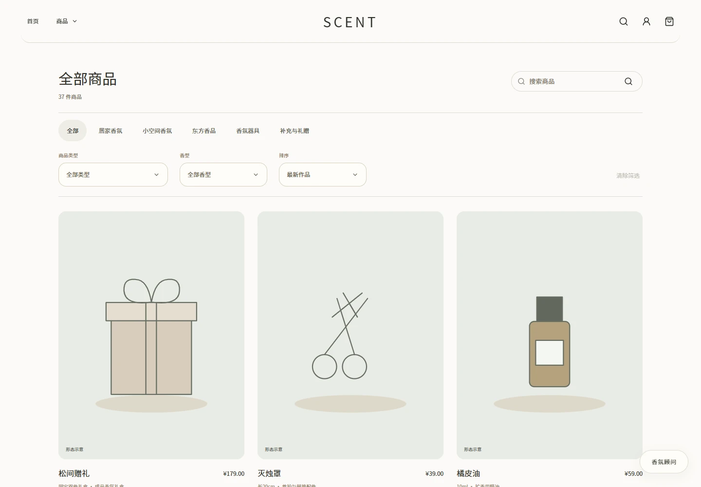
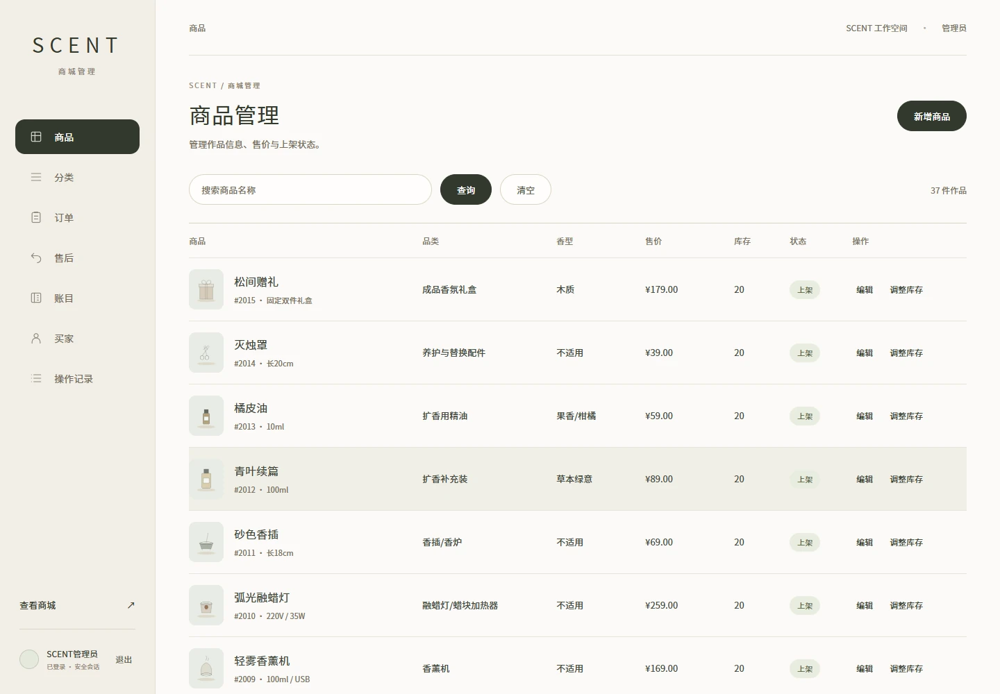
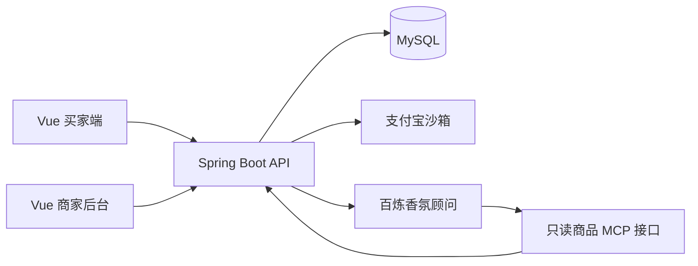

<div align="center">

# SCENT · 香氛商城

**从挑选一缕香气，到完成一次购物。**

Vue 3 买家端 · 商家后台 · Spring Boot API · AI 香氛顾问

[快速启动](#快速启动) · [功能](#功能) · [项目结构](#项目结构) · [配置说明](deploy/README.md)


</div>

SCENT 是一个单店自营香氛商城，包含完整的买家购物流程和商家处理流程。项目将品牌展示、商品选购、订单履约、售后评价与只读 AI 导购放在同一套系统中，适合学习和本地演示。


## 界面与交互

首页采用暖白、石色和深橄榄色，结合大幅光影图片、悬浮字母透视、滚动叠层与横向商品流。商城页面使用圆角卡片和克制的动效，并适配移动端与“减少动态效果”设置。

<details>
<summary>查看商品页与商家后台</summary>





</details>

## 功能

| 角色 | 可以做什么 |
| --- | --- |
| 买家 | 注册登录、搜索筛选、查看商品、购物车、收货地址、下单、查询支付结果、确认收货、申请售后、评价 |
| 商家 | 商品与分类管理、图片上传、库存调整、订单配货与发货、售后审核、退款与独立入库、收支查看、买家管理和审计记录 |
| AI 香氛顾问 | 根据需求解释香型、推荐店内商品，通过两个只读 MCP 工具查询公开商品信息；支持流式回复与当前会话 |

交易链路包含支付宝沙箱接入、回调验签、金额核对和重复请求保护。订单金额由后端计算，以整数分保存；退款与库存回补分别处理。AI 顾问不操作购物车、订单、支付或退款，也不读取买家个人资料。

**开源版自带 37 件虚构示例商品、5 大类和 18 个类型。** 商品图片与文案用于教学展示，不代表真实销售承诺。生产订单、用户数据、上传照片和服务密钥不在仓库中。

## 快速启动

适用：**Windows 10/11，64 位**。首次运行需要联网下载工具和依赖，请预留数 GB 磁盘空间。

1. 下载并完整解压仓库，或使用 `git clone`。
2. 双击根目录的 **`start.cmd`**。
3. 等待环境下载、前后端构建和数据库初始化完成。
4. 脚本会打开本地账号页，显示商城、商家后台入口及自动生成的演示账号。

```powershell
git clone https://github.com/SuMeidan/fragrance-mall-final.git SCENT
cd SCENT
.\start.cmd
```

无需预先安装 Java、Node.js、MySQL、Maven 或 Python。工具下载后会校验 SHA-256；程序只监听本机，运行环境和数据保存在项目外的独立目录。首次启动所需时间取决于网络，后续启动会复用环境、保留账号和订单。

使用完毕双击 **`stop.cmd`**。移动项目目录后会创建另一套本地环境；请先停止旧位置的服务。

> **支付和 AI 需要单独配置。** 未填写凭据时，可以浏览商城并体验账号、购物车、订单等本地流程；不会自动产生支付宝付款成功或真实 AI 回复。接入方法见 [配置与运行](deploy/README.md)。

## 技术组成

| 部分 | 技术 |
| --- | --- |
| 买家端、商家端 | Vue 3、TypeScript、Vite；商家端使用 Element Plus |
| 后端 | Java 21、Spring Boot、MyBatis、Flyway |
| 数据 | MySQL 8.4；15 张业务表，V1—V5 数据库迁移 |
| 支付 | 支付宝沙箱 |
| AI | 阿里云百炼、SSE 流式响应、只读商品 MCP 接口 |
| 验证 | JUnit、真实 MySQL 集成测试、Playwright、GitHub Actions |



## 项目结构

```text
SCENT/
├─ start.cmd / stop.cmd       本地一键启动与停止
├─ apps/
│  ├─ storefront/             买家端
│  ├─ admin/                  商家后台
│  ├─ api/                    Java API、数据库迁移和后端测试
│  └─ web-shared/             两端共用类型、请求和公开素材
├─ deploy/                    本地运行工具与配置模板
├─ tests/                     浏览器回归测试
├─ docs/images/               项目真实界面截图
├─ .github/workflows/         前后端自动检查
├─ THIRD_PARTY_NOTICES.md     开源来源与素材说明
└─ LICENSE                   GPL 许可证
```

仓库保留应用源码、数据库脚本、运行工具、测试和必要说明。课程报告、PPT、录屏、设计过程、旧试验项目及私有部署记录在仓库外保存。

## 开发与检查

前端依赖版本以 `package.json` 和 `package-lock.json` 为准。安装对应的 Node.js/npm 后，在仓库根目录运行：

```powershell
npm ci --no-fund
npm run check
npm run format:check
npm run build
```

后端测试需要独立 MySQL 测试库，步骤见 [后端说明](apps/api/README.md)。完整浏览器检查入口为 [tests/v1-browser.cjs](tests/v1-browser.cjs)，CI 的环境准备和执行顺序见 [.github/workflows/api.yml](.github/workflows/api.yml)。支付与模型测试中的受控替身不等于外部平台的真实成功。

本地一键脚本用于学习和演示。公网部署需要另外配置域名、HTTPS、外部服务回调、数据库访问控制和备份；仓库不提供作者服务器的私有配置。

## 来源与许可证

项目代码采用 **GPL-3.0-or-later**，见 [LICENSE](LICENSE)。业务参考了 newbee-mall 系列开源项目，保留相关版权声明；具体版本、适配说明和字体许可证见 [THIRD_PARTY_NOTICES.md](THIRD_PARTY_NOTICES.md)。

如提交 Issue，请先移除账号密码、密钥、真实用户信息和支付记录。
