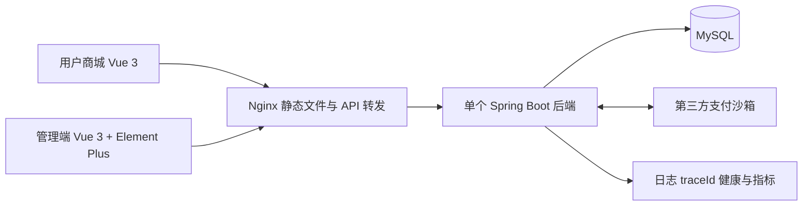

# 校园图书商城方案与执行计划

建议采用单商家校园图书商城，优先验证新蜂商城的前后端分离版本。这个方案把商业规则收敛到一个商家、一种履约方式和一条订单链，将二次开发重点放在可验收的交易正确性、安全及工程交付。

本文件是 2026-10-12 的建议基线。业务方向与底座尚待用户审阅；本轮工程文档初始化不等于正式需求冻结或应用开发完成。

## 对原链路的评估

“建远程仓库 → 选简单方向 → 复用成熟系统 → 二次开发”可行，但要加两个阶段门槛：先把课程要求转成验收清单，再让固定上游版本跑通一条最小业务链。仓库知名度说明有人使用，不能直接证明安全、完整或适合本课。

复用应减少基础页面、管理功能和数据访问的工作量；我们仍需能够解释并验证关键代码。二次开发的价值优先体现为图书场景、完整订单状态、库存与回调正确性、权限边界及可复现交付，而不是只替换名称和图片。

## 业务方向比较

以下为本次工程判断，不是市场调查结论。

| 方向 | 增加的业务规则 | 对本项目的判断 |
| --- | --- | --- |
| 单商家校园图书 | 图书基本信息、单规格库存、校内自提 | 首选；流程稳定，容易准备虚构商品和演示 |
| 普通日用品 | 颜色/规格、配送、不同品类参数 | 可做，但图书更容易收敛 |
| 校园二手 C2C | 买卖双身份、个人发布、议价、纠纷与卖家结算 | 暂不优先 |
| 生鲜/社区团购 | 保质期、重量、预售/团长、配送时段和损耗 | 暂不优先 |
| 医药/跨境 | 资质/处方或税费/币种/跨境物流规则 | 暂不优先 |

建议产品名暂用“校园图书商城”；正式展示名可在需求阶段确定。用户是学生和校内书店工作人员，场景是购买教材/参考书后到校内取书。第一版只做单商家、单仓/库存、单自提点，不做学生个人卖书。

## 核心主线与范围

主线：浏览/搜索图书 → 加入购物车 → 确认订单 → 支付沙箱 → 店员备货 → 校内取书核销 → 完成 → 评价；需要售后时走申请、审核、退款和对账。

图书采用单规格商品。候选字段：书名、作者、ISBN、出版社、封面、分类、简介、价格和库存；字段和约束需在正式需求与数据库设计中冻结。

角色建议为游客、会员、店员、管理员。店员兼顾运营、备货、售后与只读对账，管理员管理账号和权限；各写接口按操作授权，订单额外检查归属。

订单设计必须区分待支付、已支付待备货、待取书、已完成、已取消；售后另有申请/审核/退款状态和记录。待支付订单可取消或超时释放，已支付订单通过售后退款处理，防止“取消”绕过退款。支付已发出但响应丢失时需查单与补偿，不能简单重扣库存或重复收款。

结算分为购物车金额计算和商家交易对账：金额从服务端数据生成，订单保存金额快照；对账核对支付、退款与净收入。多商家分账、银行打款和复杂财务系统不进入第一版。

## 建议架构与取舍

模块化单体是“一个后端程序，内部按业务分模块”；不用拆成多个独立服务来完成同库订单与库存事务。浏览器展示页面，后端负责权限和交易规则，MySQL 保存最终状态。

该图为设计建议，当前没有对应运行服务。

| 领域 | 建议选择 | 原因与替代方案 |
| --- | --- | --- |
| 页面 | Vue 3 用户端与管理端独立工程 | 可复用新蜂页面；用户端先保持 H5 并补桌面可用性 |
| 后端 | Spring Boot + MyBatis，Controller/Service/Mapper | 延续此前课程技术经验；原版 JDK/框架先固定验证，再评估受支持版本升级 |
| 数据 | MySQL，脚本/迁移、索引、分页、连接池 | 订单/库存在一个库中事务提交；不引入跨库事务 |
| 认证 | 服务端会话与 Spring Security 为优先方案，按权限做 RBAC | 便于统一两端账号、撤销和 CSRF；实际替换需先评估上游接口与密码数据迁移成本，JWT 是替代方案 |
| 支付 | 第三方沙箱，优先调研支付宝沙箱 | 需要账号/凭据及回调可达性；开发桩只能做本地测试 |
| 超时/补偿 | 单体定时任务 + 数据库状态/唯一约束 | 处理未支付超时和支付/退款状态核对；跨支付平台不能与数据库做同一个事务 |
| 运维 | Docker Compose + Nginx，配置分离 | 用较少服务实现可复现启动；服务器和 HTTPS 入口另行确定 |
| 监控/CI | 应用指标与结构化日志、GitHub Actions CI | 先有可观察证据；图表平台和自动生产部署按实际需要再加 |

初版缓存、MQ、注册中心、微服务网关、搜索引擎和 K8s 均不采用。搜索先用参数绑定 SQL、分页及适当索引；是否需要缓存由测量决定。外部支付一致性先采用状态机、幂等记录、查单与定时补偿，必要时加本地事件表；不以单库事务声称已经解决跨系统原子提交。

不在导入时同时升级全部依赖。原版成功运行是诊断基线，不是允许将过时依赖或示例安全方案直接部署；正式交付前处理所选版本的安全与支持状态。

## 实施阶段与退出条件

| 阶段 | 输入与工作 | 输出和通过条件 | 当前状态 |
| --- | --- | --- | --- |
| S0 工程准备 | 任务书、课程材料、GitHub 账号、在线候选源码 | 私有仓库、工程索引、验收基线、源码调研、AI记录，Git同步一致 | 本轮执行 |
| S1 需求与设计冻结 | 用户审阅、成员/期限、课程复用边界、上游缺口 | 角色矩阵、交易/退款状态、ER、API、版本/依赖与决策；明确验收范围 | 未开始 |
| S2 上游最小验证 | 固定 SHA、许可证、隔离环境、虚构数据 | 原版构建并跑通注册/登录、商品、购物车、下单和管理履约；识别模拟支付和兼容问题 | 未开始 |
| S3 正式导入与业务适配 | S2证据、采用决定 | 保留来源和版权；图书数据、分类、页面、自提流程；每模块小范围验证 | 未开始 |
| S4 交易与安全补齐 | 订单/权限/支付设计 | 沙箱支付与退款、库存并发/恢复、下单/通知幂等、密码和RBAC、售后评价对账 | 未开始 |
| S5 工程化与综合验收 | 已完成业务链 | 单元/集成/E2E、异常与权限、OpenAPI、CI、覆盖率、日志指标、受控压测 | 未开始 |
| S6 可复现部署 | 固定源码、配置/数据库/部署脚本 | 干净环境重建、重启/备份恢复/回滚；授权后服务器验证与HTTPS | 未开始 |
| S7 课程交付 | 实际系统与原始证据 | 三份文档、源码脚本压缩包、PPT、≤15分钟真实演示视频 | 未开始 |

本轮只执行 S0。下一轮从 S1/S2 开始，不跨过验证门槛直接全面改造。每阶段使用“设计 → 小范围实现/验证 → 修正 → 记录 → 提交”，阶段报告区分应用验收与文档准备。

S2 先用 5—10 本虚构图书、2 个会员和 1 个管理员账号，单人顺序请求；补齐 RBAC 后再加入店员账号与权限实验。原版成功后才测试库存 1 的 10 并发。测试库、端口和 Compose 项目名应与以前实验隔离，不覆盖已有服务。

如果用户业务方向改变、教师明确限制复用、三套上游协议无法低成本对齐、构建依赖无法取得、核心交易缺口大到需要整体重写，暂停导入并重新比较。缺少沙箱账号或回调条件时可继续其他模块，但 R04 必须保持未验收。限定批次失败或数据不一致时停止扩量，保留证据。

## 当前需要补充的信息

业务方向审阅、小组人数与成员分工、提交截止时间、是否有额外复用规定、沙箱账号和最终部署入口。它们不阻塞本轮仓库与管理文件建立；需求冻结和外部集成前必须补齐相关信息。
